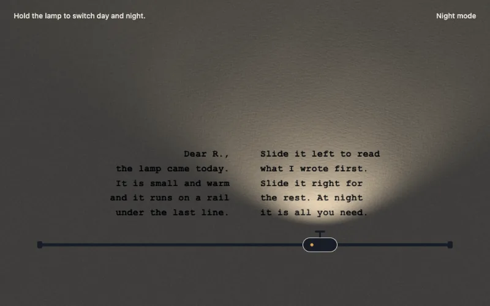
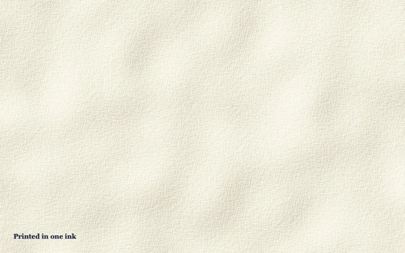
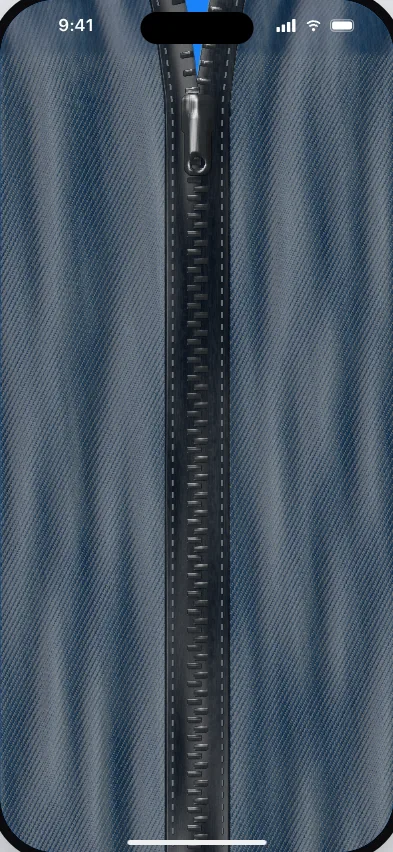

<p align="center">
  <a href="https://bnhoang2k.github.io/paint-kit/#10-foil-card"><picture><source media="(prefers-color-scheme: dark)" srcset="media/10-foil-card-dark.webp"></picture></a>
</p>

# paint-kit

Paint web surfaces in WebGL2 that take real light: paper under a lamp, denim, halftone dots, water, frosted glass,
foil, hot steel and burning card. A surface is a material, drawn from a field, lit by lights, with every colour taken
from the page's own CSS. A gate then checks the page against what real light does: move the key light and the
relief must change, a lamp must dim with distance, a highlight must move toward the light.

**[Open the live bars](https://bnhoang2k.github.io/paint-kit/)**: each one runs in your browser and answers the pointer.

## The bars

A bar is a finished page that passes the gate and was kept by eye in a live review. Copy the nearest one, change its
words and colours, and gate it. [`bars/INDEX.md`](bars/INDEX.md) says what each fits and what it is wrong for.

<p>
  <a href="https://bnhoang2k.github.io/paint-kit/#01-lamp-on-paper"><picture><source media="(prefers-color-scheme: dark)" srcset="media/01-lamp-on-paper-dark.webp"></picture></a>
  <a href="https://bnhoang2k.github.io/paint-kit/#06-glimmer"><picture><source media="(prefers-color-scheme: dark)" srcset="media/06-glimmer-dark.webp"></picture></a>
  <a href="https://bnhoang2k.github.io/paint-kit/#07-light-stamp"><picture><source media="(prefers-color-scheme: dark)" srcset="media/07-light-stamp-dark.webp"></picture></a>
  <a href="https://bnhoang2k.github.io/paint-kit/#11-heat-tint"><picture><source media="(prefers-color-scheme: dark)" srcset="media/11-heat-tint-dark.webp"></picture></a>
  <a href="https://bnhoang2k.github.io/paint-kit/#03-halftone-resolve"><picture><source media="(prefers-color-scheme: dark)" srcset="media/03-halftone-resolve-dark.webp"></picture></a>
  <a href="https://bnhoang2k.github.io/paint-kit/#04-paper-shred"><picture><source media="(prefers-color-scheme: dark)" srcset="media/04-paper-shred-dark.webp"></picture></a>
  <a href="https://bnhoang2k.github.io/paint-kit/#12-burn-card"></a>
  <a href="https://bnhoang2k.github.io/paint-kit/#10-foil-card"><picture><source media="(prefers-color-scheme: dark)" srcset="media/10-foil-card-dark.webp"></picture></a>
</p>
<p>
  <a href="https://bnhoang2k.github.io/paint-kit/#02-denim-zip"><picture><source media="(prefers-color-scheme: dark)" srcset="media/02-denim-zip-dark.webp"></picture></a>
  <a href="https://bnhoang2k.github.io/paint-kit/#05-pool-light"><picture><source media="(prefers-color-scheme: dark)" srcset="media/05-pool-light-dark.webp"></picture></a>
</p>

## Use it

```bash
pnpm install
pnpm exec playwright install chromium
pnpm build
node dist/src/cli/paint-kit.js gate bars/01-lamp-on-paper
```

A page loads the engine as `paint-kit` through an import map, with no bundler:

```js
import { paint, fields, materials, lights, fromPage } from "paint-kit";

const painter = paint(canvas, {
  seed: 7,
  detail: 0.6,
  palette: fromPage({ ground: "--ground", ink: "--ink", accents: ["--accent"] }),
  fields: [fields.sheet({ warp: 0.5 }), fields.text()],
  materials: [materials.paper()],
  lights: [lights.lamp({ at: [0.5, -0.2, 0.6], aim: [0.5, 0.6, 0], cone: 28, soft: 8, level: 1, kelvin: 3200 }), lights.ambient(0.08)],
  finish: { grain: 0.04 },
});
```

- [`REFERENCE.md`](REFERENCE.md): every field, material, light and hook member.
- [`AGENTS.md`](AGENTS.md): the steps a coding agent follows to paint a surface (name it and its laws, find a bar,
  copy or build, gate, look at the sheet).
- `paint-kit gate <page>` runs nine checks (render, palette, banding and grain, still frames, hygiene, the light laws,
  detail, text contrast, flashes) at every seed in the page's `bar.json`, in light and dark.
  `paint-kit sheet <page> --out sheet.png` renders a contact sheet of seeds, schemes, detail levels and light positions.

Without WebGL2 a page shows its ground colour and stays readable, and under reduced motion it settles on one still
frame. Node 26 or later.

## Licence

MIT
