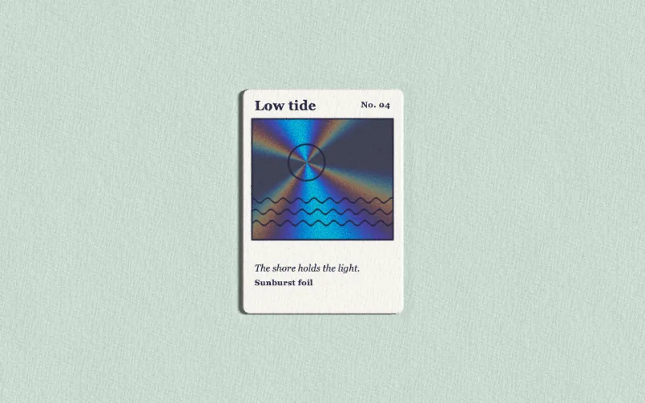
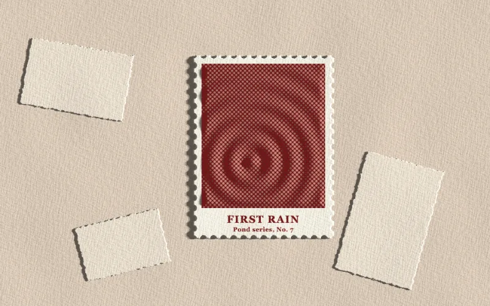
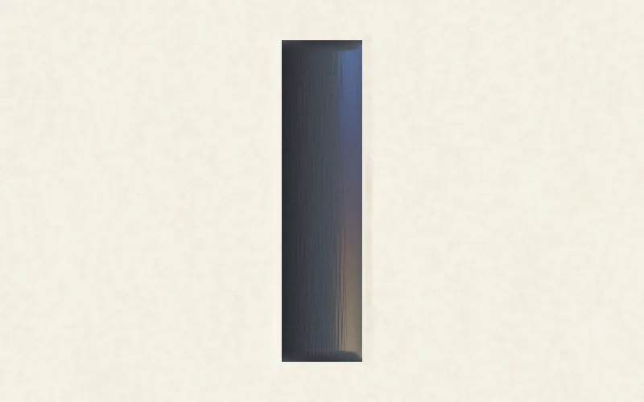
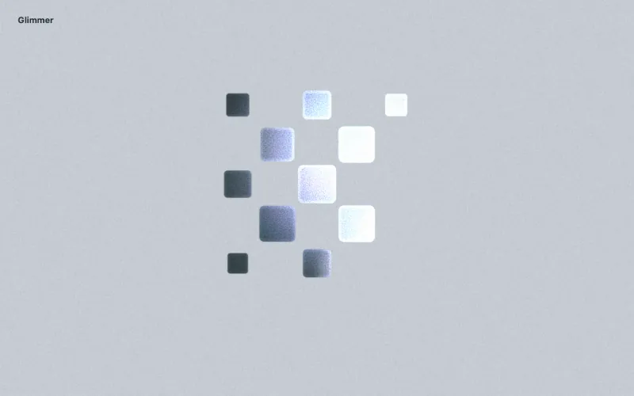
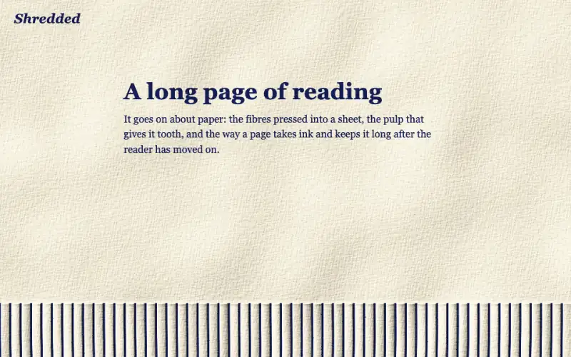
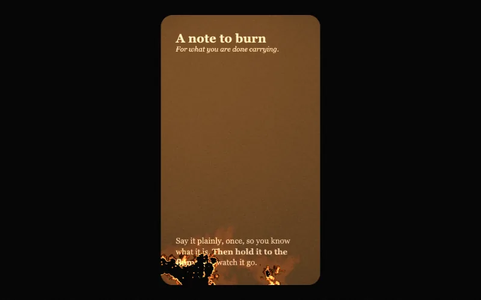
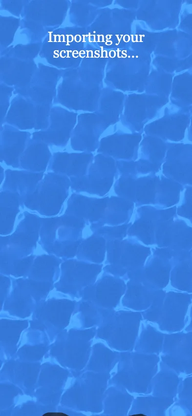

<p align="center">
  <a href="https://bnhoang2k.github.io/paint-kit/#10-foil-card"><picture><source media="(prefers-color-scheme: dark)" srcset="media/10-foil-card-dark.webp"></picture></a>
</p>

# paint-kit

Paint web pages that look made of real stuff (paper, denim, glass, water, foil, hot steel) and
that light falls on the way it falls on the real thing.

An AI coding tool can write a WebGL shader. It cannot see that its paper looks like plastic, that
its lamp glows the same everywhere, or that its shine is painted on and stays put when the light
moves. paint-kit gives the tool finished example pages to start from and a gate to finish with.
The gate checks the page against what real light does: move the light and the bumps must change,
a lamp must dim with distance, a highlight must slide toward the light. A page is done when the
gate passes and its contact sheet looks right.

**[Play with every example live](https://bnhoang2k.github.io/paint-kit/)**. Each one runs in your
browser and answers the pointer.

<sub>Above: the foil card, one of the ten examples. Click any picture to open it live.</sub>

## What it makes

<p align="center">
  <a href="https://bnhoang2k.github.io/paint-kit/#01-lamp-on-paper"><picture><source media="(prefers-color-scheme: dark)" srcset="media/01-lamp-on-paper-dark.webp"></picture></a>
  <a href="https://bnhoang2k.github.io/paint-kit/#07-light-stamp"><picture><source media="(prefers-color-scheme: dark)" srcset="media/07-light-stamp-dark.webp"></picture></a>
</p>

**Light you move.** A lamp on a rail lights only the words it passes. An embossed stamp's bumps
and shadow turn as the pointer, which is the light, goes round it.

<p align="center">
  <a href="https://bnhoang2k.github.io/paint-kit/#10-foil-card"><picture><source media="(prefers-color-scheme: dark)" srcset="media/10-foil-card-dark.webp"></picture></a>
  <a href="https://bnhoang2k.github.io/paint-kit/#11-heat-tint"><picture><source media="(prefers-color-scheme: dark)" srcset="media/11-heat-tint-dark.webp"></picture></a>
</p>

**Colour that light makes.** Foil and heated steel get their rainbow from light bouncing in very
thin layers. So the colour shifts when the light or the tilt moves, and never on its own.

<p align="center">
  <a href="https://bnhoang2k.github.io/paint-kit/#06-glimmer"><picture><source media="(prefers-color-scheme: dark)" srcset="media/06-glimmer-dark.webp"></picture></a>
  <a href="https://bnhoang2k.github.io/paint-kit/#03-halftone-resolve"><picture><source media="(prefers-color-scheme: dark)" srcset="media/03-halftone-resolve-dark.webp"></picture></a>
</p>

**Glass and print.** Frosted tiles lit from behind, where only a few glow. A picture that arrives
as printed dots, coarse first, then fine.

<p align="center">
  <a href="https://bnhoang2k.github.io/paint-kit/#04-paper-shred"><picture><source media="(prefers-color-scheme: dark)" srcset="media/04-paper-shred-dark.webp"></picture></a>
  <a href="https://bnhoang2k.github.io/paint-kit/#12-burn-card"></a>
</p>

**Paper that moves.** A page that tears into swaying strips as you scroll. A card that burns away
from torn holes, with a hot rim and specks that cool.

<p align="center">
  <a href="https://bnhoang2k.github.io/paint-kit/#02-denim-zip"><picture><source media="(prefers-color-scheme: dark)" srcset="media/02-denim-zip-dark.webp"></picture></a>
  <a href="https://bnhoang2k.github.io/paint-kit/#05-pool-light"><picture><source media="(prefers-color-scheme: dark)" srcset="media/05-pool-light-dark.webp"></picture></a>
</p>

**On a phone.** Denim with a metal zip you pull open. Water over the screen, with moving lines of
light on a card below.

## Use it

You need Node 26 and [pnpm](https://pnpm.io/installation).

```bash
git clone https://github.com/bnhoang2k/paint-kit
cd paint-kit
pnpm install
pnpm exec playwright install chromium
pnpm build
```

Then ask your coding agent for a surface and point it at [AGENTS.md](AGENTS.md). It picks the
nearest example, copies it, changes the words and colours, and runs the gate until it passes.
Every colour comes from your page's own CSS, so the result matches your site.

## Check a page yourself

```bash
node dist/src/cli/paint-kit.js gate bars/01-lamp-on-paper
node dist/src/cli/paint-kit.js sheet bars/01-lamp-on-paper --out sheet.png
```

The gate prints `passed`, `partial` or `failed: n`, and a line for each check. The sheet draws the
page side by side at three seeds, in light and dark, at three levels of detail, and with the light
in two places, so you can see at a glance whether the light is real or painted on.

## More

- [REFERENCE.md](REFERENCE.md): every surface, material, light and option.
- [bars/INDEX.md](bars/INDEX.md): the ten examples, what each one fits, and what it is wrong for.
- [scripts/record-clips.mjs](scripts/record-clips.mjs): records the loops above from the live pages.

MIT licence.
